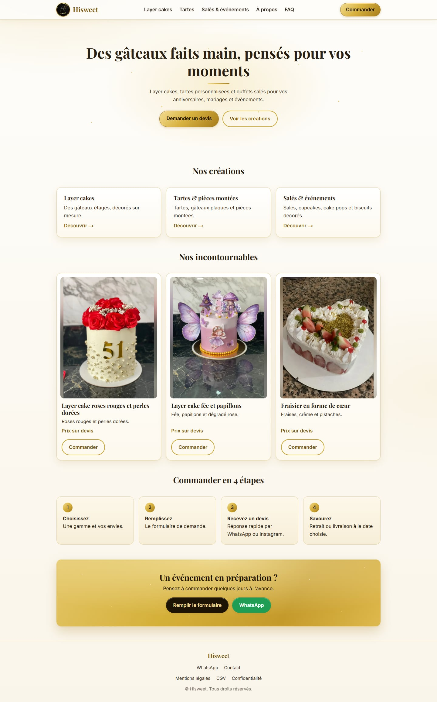
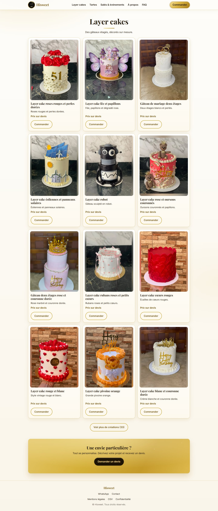
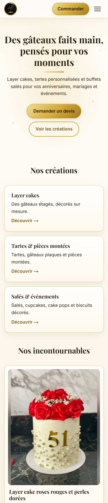

# Hisweet

**Français** · [English](README.md)

Site vitrine d'une pâtisserie sur mesure : layer cakes, tartes et pièces montées, salés et douceurs pour les fêtes. Les visiteurs parcourent le catalogue et envoient une demande de devis ; il n'y a ni paiement en ligne ni grille de prix publique, chaque commande est chiffrée au cas par cas.

Le site est en français et repose sur Next.js, React et TypeScript.

<p align="center">
  
</p>

## Fonctionnalités

- **Catalogue par gamme** : layer cakes, tartes et pièces montées, salés et événements. Tout vient de deux fichiers JSON : ajouter une création ne demande pas de toucher au code.
- **Cartes uniformes** : chaque photo s'affiche en entier dans un cadre identique (sans recadrage), avec un bouton « Voir plus » qui révèle le catalogue par paquets de 12.
- **Formulaire de demande de devis** : type de commande, demande libre, date avec délai minimum, nombre de personnes, retrait ou livraison, allergies, identifiant Instagram facultatif et jusqu'à trois photos de modèle. Les photos sont réduites et converties en JPEG dans le navigateur, puis jointes à l'e-mail de notification.
- **Raccourci WhatsApp** avec un message pré-rempli à partir du formulaire.
- **Validation côté serveur**, champ piège contre les robots et limitation du nombre de requêtes par IP sur la route d'API.
- **SEO** : métadonnées par page, image Open Graph, `sitemap.xml`, `robots.txt` et données structurées JSON-LD.
- **Pages légales** (mentions légales, CGV, confidentialité) alimentées par des variables d'environnement : aucune donnée personnelle n'est stockée dans le dépôt.
- **Animations en CSS pur** (apparition au défilement, bandeau d'étoiles filantes, effets au survol), désactivées pour les visiteurs qui demandent de réduire les animations.
- **Mise en page adaptative**, testée du petit téléphone au grand écran.

## Captures d'écran

<p align="center">
  
  
</p>

## Technologies

| Domaine | Choix |
| --- | --- |
| Framework | [Next.js](https://nextjs.org/) 16 (App Router) |
| Interface | React 19, CSS Modules |
| Langage | TypeScript |
| E-mail | [Resend](https://resend.com/) (demandes de devis, avec photos en pièces jointes) |
| Données | Fichiers JSON (`src/data`) |
| Qualité | ESLint (`eslint-config-next`) |

Nécessite Node.js 20.9 ou plus récent.

## Démarrage

```bash
git clone <url-du-depot>
cd <dossier-du-depot>
npm install
cp .env.example .env.local   # puis renseigner les valeurs
npm run dev
```

Le site est ensuite disponible sur <http://localhost:3000>.

### Variables d'environnement

Copiez `.env.example` vers `.env.local`. Ce fichier est ignoré par Git et ne doit jamais être publié.
Les variables commençant par `NEXT_PUBLIC_` sont intégrées au code envoyé au navigateur : n'y mettez jamais de secret.

| Variable | Requise | Description |
| --- | --- | --- |
| `RESEND_API_KEY` | pour le formulaire | Clé d'API Resend (serveur uniquement) |
| `ORDER_TO_EMAIL` | pour le formulaire | Adresse qui reçoit les demandes de devis |
| `ORDER_FROM_EMAIL` | non | Expéditeur vérifié sur Resend (par défaut `onboarding@resend.dev`, qui ne peut écrire qu'au propriétaire du compte Resend) |
| `NEXT_PUBLIC_SITE_URL` | en production | URL publique, utilisée par le sitemap et les balises Open Graph |
| `NEXT_PUBLIC_MIN_LEAD_DAYS` | non | Délai minimum de commande, en jours (3 par défaut) |
| `NEXT_PUBLIC_CITY` | non | Ville affichée dans le pied de page |
| `NEXT_PUBLIC_WHATSAPP` | non | Numéro WhatsApp au format international sans `+` (ex. `33612345678`) ; le bouton est masqué si vide |
| `NEXT_PUBLIC_INSTAGRAM_URL`, `NEXT_PUBLIC_FACEBOOK_URL` | non | Liens des réseaux sociaux (pied de page, page contact) |
| `NEXT_PUBLIC_LEGAL_*`, `NEXT_PUBLIC_HOST_*`, `NEXT_PUBLIC_MEDIATOR` | pour les pages légales | Éditeur, hébergeur et médiateur des pages légales |

### Scripts

| Commande | Rôle |
| --- | --- |
| `npm run dev` | Serveur de développement avec rechargement automatique |
| `npm run build` | Build de production |
| `npm start` | Sert le build de production |
| `npm run lint` | Lance ESLint |

## Structure du projet

```text
src/
  app/              Routes : pages, /api/commande, sitemap, robots, image Open Graph
  components/       Header, Footer, ProductCard, ProductGrid, OrderForm, Mirage, ...
  data/             categories.json et products.json (le catalogue)
  lib/              Accès au catalogue, validation des commandes, réglages du site et mentions légales
  types/            Types TypeScript partagés
public/images/      Logo et photos du catalogue (WebP)
docs/screenshots/   Images utilisées dans ce README
```

## Gérer le catalogue

1. Déposez la photo dans `public/images/<gamme>/`, de préférence en WebP d'environ 960 px de large.
2. Ajoutez une entrée dans `src/data/products.json` :

   ```json
   {
     "id": "layer-cake-exemple",
     "category": "layer-cakes",
     "name": "Layer cake exemple",
     "description": "Une courte ligne.",
     "featured": false,
     "images": [
       { "src": "/images/layer-cakes/exemple.webp", "alt": "Décrire la photo", "width": 960, "height": 1280 }
     ]
   }
   ```

   `category` vaut `layer-cakes`, `tartes` ou `sales-evenements`. `width` et `height` doivent correspondre au fichier image. Mettez `featured` à `true` pour afficher la création dans la sélection de l'accueil.
3. Les gammes (nom et courte description) se modifient dans `src/data/categories.json`.

## Déploiement

Tout hébergeur compatible Next.js convient (par exemple Vercel). Renseignez les variables d'environnement du tableau ci-dessus dans les réglages de l'hébergeur. Pour envoyer les e-mails de devis vers n'importe quelle adresse, vérifiez votre domaine sur Resend et définissez `ORDER_FROM_EMAIL`.

Avant la mise en ligne, complétez les pages légales et les quelques mentions `[À compléter]` restantes (CGV, FAQ), et définissez `NEXT_PUBLIC_SITE_URL`.

## Licence

Photos, logo et textes © Hisweet, tous droits réservés. Ils ne peuvent pas être réutilisés sans autorisation.
