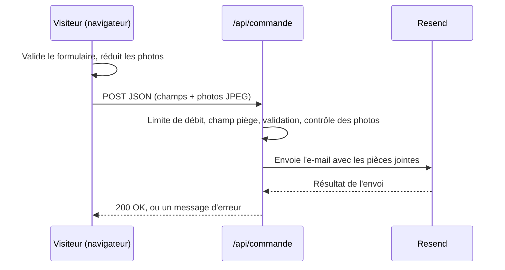

# Hisweet

**Français** · [English](README.md)

Site vitrine d'une pâtisserie sur mesure : layer cakes, tartes et pièces montées, salés et douceurs pour les fêtes. Les visiteurs parcourent le catalogue et envoient une demande de devis ; il n'y a ni paiement en ligne ni grille de prix publique, chaque commande est chiffrée au cas par cas.

Le site est en français et repose sur Next.js, React et TypeScript.

<p align="center">
  
</p>

## Fonctionnalités

- **Catalogue par gamme** : layer cakes, tartes et pièces montées, salés et événements. Tout vient de deux fichiers JSON : ajouter une création ne demande pas de toucher au code.
- **Cartes uniformes** : chaque photo s'affiche en entier dans un cadre identique (sans recadrage), avec un bouton « Voir plus » qui révèle le catalogue par paquets de 12.
- **Formulaire de demande de devis** : type de commande, demande libre, date avec délai minimum, nombre de personnes, retrait ou livraison, allergies, identifiant Instagram facultatif et jusqu'à trois photos de modèle. Les photos sont réduites et converties en JPEG dans le navigateur, puis jointes à l'e-mail de notification.
- **Raccourci WhatsApp** avec un message pré-rempli à partir du formulaire.
- **Validation côté serveur**, champ piège contre les robots et limitation du nombre de requêtes par IP sur la route d'API.
- **SEO** : métadonnées par page, image Open Graph, `sitemap.xml`, `robots.txt` et données structurées JSON-LD.
- **Pages légales** (mentions légales, CGV, confidentialité) alimentées par des variables d'environnement : aucune donnée personnelle n'est stockée dans le dépôt.
- **Animations en CSS pur** (apparition au défilement, bandeau d'étoiles filantes, effets au survol), désactivées pour les visiteurs qui demandent de réduire les animations.
- **Mise en page adaptative**, testée du petit téléphone au grand écran.

## Captures d'écran

<p align="center">
  
  
</p>

## Technologies

| Domaine | Choix |
| --- | --- |
| Framework | [Next.js](https://nextjs.org/) 16 (App Router) |
| Interface | React 19, CSS Modules |
| Langage | TypeScript |
| E-mail | [Resend](https://resend.com/) (demandes de devis, avec photos en pièces jointes) |
| Données | Fichiers JSON (`src/data`) |
| Qualité | ESLint (`eslint-config-next`) |

Nécessite Node.js 20.9 ou plus récent.

## Démarrage

```bash
git clone <url-du-depot>
cd <dossier-du-depot>
npm install
cp .env.example .env.local   # puis renseigner les valeurs
npm run dev
```

Le site est ensuite disponible sur <http://localhost:3000>.

### Variables d'environnement

Copiez `.env.example` vers `.env.local`. Ce fichier est ignoré par Git et ne doit jamais être publié.
Les variables commençant par `NEXT_PUBLIC_` sont intégrées au code envoyé au navigateur : n'y mettez jamais de secret.

| Variable | Requise | Description |
| --- | --- | --- |
| `RESEND_API_KEY` | pour le formulaire | Clé d'API Resend (serveur uniquement) |
| `ORDER_TO_EMAIL` | pour le formulaire | Adresse qui reçoit les demandes de devis |
| `ORDER_FROM_EMAIL` | non | Expéditeur vérifié sur Resend (par défaut `onboarding@resend.dev`, qui ne peut écrire qu'au propriétaire du compte Resend) |
| `NEXT_PUBLIC_SITE_URL` | en production | URL publique, utilisée par le sitemap et les balises Open Graph |
| `NEXT_PUBLIC_MIN_LEAD_DAYS` | non | Délai minimum de commande, en jours (3 par défaut) |
| `NEXT_PUBLIC_CITY` | non | Ville affichée dans le pied de page |
| `NEXT_PUBLIC_WHATSAPP` | non | Numéro WhatsApp au format international sans `+` (ex. `33612345678`) ; le bouton est masqué si vide |
| `NEXT_PUBLIC_INSTAGRAM_URL`, `NEXT_PUBLIC_FACEBOOK_URL` | non | Liens des réseaux sociaux (pied de page, page contact) |
| `NEXT_PUBLIC_LEGAL_*`, `NEXT_PUBLIC_HOST_*`, `NEXT_PUBLIC_MEDIATOR` | pour les pages légales | Éditeur, hébergeur et médiateur des pages légales |

### Scripts

| Commande | Rôle |
| --- | --- |
| `npm run dev` | Serveur de développement avec rechargement automatique |
| `npm run build` | Build de production |
| `npm start` | Sert le build de production |
| `npm run lint` | Lance ESLint |

## Structure du projet

```text
src/
  app/              Routes : pages, /api/commande, sitemap, robots, image Open Graph
  components/       Header, Footer, ProductCard, ProductGrid, OrderForm, Mirage, ...
  data/             categories.json et products.json (le catalogue)
  lib/              Accès au catalogue, validation des commandes, réglages du site et mentions légales
  types/            Types TypeScript partagés
public/images/      Logo et photos du catalogue (WebP)
docs/screenshots/   Images utilisées dans ce README
```

## Comment il est construit

Le site est une seule application Next.js : le front end et le petit back end vivent dans le même dépôt et sont déployés ensemble. Il n'y a pas de base de données ; le catalogue est lu dans des fichiers JSON au moment du build, et les demandes de devis sont transmises par e-mail.

### Front end

- **Rendu** : chaque page est un composant serveur React, prérendu au build. Les composants client se limitent à ce qui est interactif : le menu mobile (`Header`), le bouton « Voir plus » (`ProductGrid`) et le formulaire de devis (`OrderForm`).
- **Routage** : App Router. Les trois pages de gamme sont de fines routes qui partagent un même composant `CategoryView`, alimenté par l'identifiant de la gamme.
- **Style** : un CSS Module par composant, au-dessus de « design tokens » globaux (couleurs, dégradés, ombres, rayons, courbes d'animation) déclarés en variables CSS dans `src/app/globals.css`. Les polices (Playfair Display, Inter) sont auto-hébergées au build avec `next/font`.
- **Images** : fichiers WebP servis par `next/image`. Les cartes partagent un cadre fixe ; la photo s'y affiche en entier (`object-fit: contain`) sur une copie floutée d'elle-même, donc rien n'est rogné quel que soit le format de la photo.
- **Animations** : en CSS uniquement. Les animations liées au défilement (`animation-timeline: view()` et `scroll()`) sont placées dans des blocs `@supports` : les navigateurs qui ne les gèrent pas affichent simplement le contenu. Le bandeau d'étoiles filantes utilise les unités de requête de conteneur (`cqw`) pour traverser le bloc quelle que soit sa largeur. Tout est désactivé avec `prefers-reduced-motion`.
- **Données et types** : le catalogue est typé avec des interfaces TypeScript (`src/types/product.ts`) et lu via les fonctions de `src/lib/products.ts`.
- **Formulaire de devis** : les règles de validation sont dans un module partagé (`src/lib/order.ts`), utilisé dans le navigateur comme sur le serveur. Les photos de modèle sont traitées dans le navigateur (`src/lib/photo.ts`) : chacune est dessinée sur un canvas, réduite à 1600 px, réencodée en JPEG sous 1,5 Mo et envoyée en base64.
- **SEO et accessibilité** : métadonnées via l'API Metadata de Next.js, `sitemap.ts`, `robots.ts`, image Open Graph générée, données structurées JSON-LD, repères sémantiques, styles de focus visibles, champs de formulaire étiquetés avec messages d'erreur associés, et texte `alt` descriptif sur chaque photo.

### Back end

Le back end est un unique Route Handler, `POST /api/commande` (`src/app/api/commande/route.ts`). Pour chaque requête, il :

1. refuse les corps trop volumineux (HTTP 413) et applique une limite de 5 requêtes par IP toutes les 10 minutes (HTTP 429) ;
2. lit le JSON et ignore sans bruit les envois dont le champ piège caché est rempli ;
3. valide les champs avec le module partagé et vérifie le type de commande par rapport à la liste construite à partir du catalogue (HTTP 422 avec des messages par champ) ;
4. contrôle chaque photo : signature JPEG, 3 fichiers au maximum, 1,5 Mo chacun ;
5. échappe toutes les saisies et envoie la notification avec le SDK Resend, photos en pièces jointes (HTTP 502 si l'envoi échoue, 500 si le serveur n'est pas configuré).

Les secrets (`RESEND_API_KEY`, `ORDER_TO_EMAIL`) ne sont lus que dans des variables d'environnement côté serveur. Rien de ce qui est reçu n'est conservé sur le serveur. Le limiteur garde ses compteurs en mémoire : sur un hébergeur « serverless », la limite s'applique donc par instance.



### Démarche de développement

1. **Modèle de contenu** : définir les gammes et la forme d'une entrée du catalogue, sans prix, pour qu'ajouter une création revienne à modifier du JSON.
2. **Système de design** : fixer palette, typographie, espacements et effets sous forme de variables CSS avant de construire la moindre page.
3. **Pages et composants** : construire la structure (en-tête, pied de page), l'accueil, la vue de gamme partagée, puis les pages statiques (à propos, FAQ, contact, légales).
4. **Formulaire de devis et API** : écrire d'abord la validation partagée, puis le formulaire, puis le Route Handler et l'envoi des e-mails.
5. **SEO et légal** : métadonnées, sitemap, données structurées, et pages légales alimentées par des variables d'environnement.
6. **Contrôles** : vérification des types et lint à chaque modification, builds de production, audits Lighthouse sur les pages principales, et vérifications manuelles en largeur mobile et ordinateur.

## Gérer le catalogue

1. Déposez la photo dans `public/images/<gamme>/`, de préférence en WebP d'environ 960 px de large.
2. Ajoutez une entrée dans `src/data/products.json` :

   ```json
   {
     "id": "layer-cake-exemple",
     "category": "layer-cakes",
     "name": "Layer cake exemple",
     "description": "Une courte ligne.",
     "featured": false,
     "images": [
       { "src": "/images/layer-cakes/exemple.webp", "alt": "Décrire la photo", "width": 960, "height": 1280 }
     ]
   }
   ```

   `category` vaut `layer-cakes`, `tartes` ou `sales-evenements`. `width` et `height` doivent correspondre au fichier image. Mettez `featured` à `true` pour afficher la création dans la sélection de l'accueil.
3. Les gammes (nom et courte description) se modifient dans `src/data/categories.json`.

## Déploiement

Tout hébergeur compatible Next.js convient (par exemple Vercel). Renseignez les variables d'environnement du tableau ci-dessus dans les réglages de l'hébergeur. Pour envoyer les e-mails de devis vers n'importe quelle adresse, vérifiez votre domaine sur Resend et définissez `ORDER_FROM_EMAIL`.

Avant la mise en ligne, complétez les pages légales et les quelques mentions `[À compléter]` restantes (CGV, FAQ), et définissez `NEXT_PUBLIC_SITE_URL`.

## Licence

Photos, logo et textes © Hisweet, tous droits réservés. Ils ne peuvent pas être réutilisés sans autorisation.
