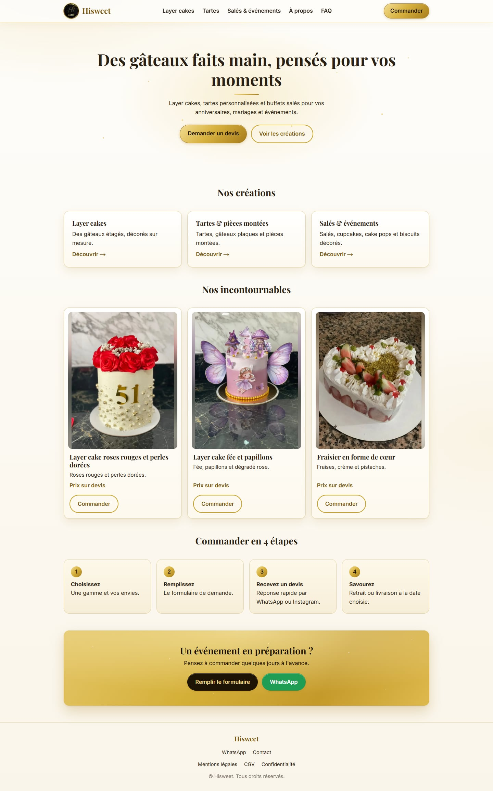
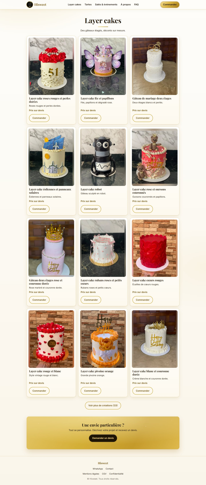
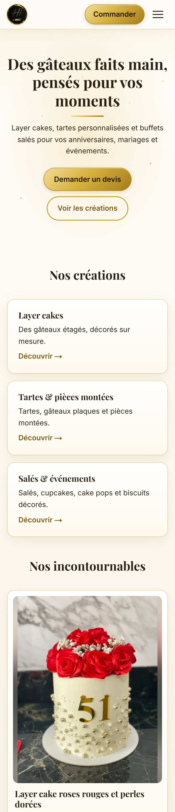

# Hisweet

[Français](README.fr.md) · **English**

Showcase website for a custom pastry business: layer cakes, tarts and centrepieces, savoury treats and party sweets. Visitors browse the catalogue and send a quote request; there is no online payment and no public price list, every order is quoted individually.

The site is in French and is built with Next.js, React and TypeScript.

<p align="center">
  
</p>

## Features

- **Catalogue by category**: layer cakes, tarts and centrepieces, savoury and events. Everything comes from two JSON files, so adding a creation does not require touching the code.
- **Uniform cards**: each photo is shown in full inside an identical frame (no cropping), with a "show more" button that reveals the catalogue 12 items at a time.
- **Quote request form**: order type, free-text request, date with a minimum lead time, number of guests, pickup or delivery, allergies, optional Instagram handle and up to three reference photos. Photos are resized and converted to JPEG in the browser, then attached to the notification e-mail.
- **WhatsApp shortcut** with a pre-filled message built from the form.
- **Server-side validation**, a honeypot field against bots and a per-IP rate limit on the API route.
- **SEO**: page metadata, Open Graph image, `sitemap.xml`, `robots.txt` and JSON-LD structured data.
- **Legal pages** (legal notice, terms of sale, privacy policy) filled in from environment variables, so no personal data lives in the repository.
- **Animations written in plain CSS** (scroll reveals, shooting-star banner, hover effects) that switch off for visitors who prefer reduced motion.
- **Responsive** layout, tested from small phones to wide desktops.

## Screenshots

<p align="center">
  
  
</p>

## Tech stack

| Area | Choice |
| --- | --- |
| Framework | [Next.js](https://nextjs.org/) 16 (App Router) |
| UI | React 19, CSS Modules |
| Language | TypeScript |
| E-mail | [Resend](https://resend.com/) (quote requests, with photo attachments) |
| Data | JSON files (`src/data`) |
| Linting | ESLint (`eslint-config-next`) |

Requires Node.js 20.9 or later.

## Getting started

```bash
git clone <repository-url>
cd <repository-folder>
npm install
cp .env.example .env.local   # then fill in the values
npm run dev
```

The site is then available at <http://localhost:3000>.

### Environment variables

Copy `.env.example` to `.env.local`. This file is ignored by Git and must never be committed.
Variables starting with `NEXT_PUBLIC_` are embedded in the browser bundle: never put a secret in them.

| Variable | Required | Description |
| --- | --- | --- |
| `RESEND_API_KEY` | for the form | Resend API key (server only) |
| `ORDER_TO_EMAIL` | for the form | Address that receives the quote requests |
| `ORDER_FROM_EMAIL` | no | Sender verified on Resend (defaults to `onboarding@resend.dev`, which can only deliver to the Resend account owner) |
| `NEXT_PUBLIC_SITE_URL` | in production | Public URL, used by the sitemap and Open Graph tags |
| `NEXT_PUBLIC_MIN_LEAD_DAYS` | no | Minimum lead time for an order, in days (default `3`) |
| `NEXT_PUBLIC_CITY` | no | Town shown in the footer |
| `NEXT_PUBLIC_WHATSAPP` | no | WhatsApp number, international format without `+` (e.g. `33612345678`); the button is hidden when empty |
| `NEXT_PUBLIC_INSTAGRAM_URL`, `NEXT_PUBLIC_FACEBOOK_URL` | no | Social links shown in the footer and contact page |
| `NEXT_PUBLIC_LEGAL_*`, `NEXT_PUBLIC_HOST_*`, `NEXT_PUBLIC_MEDIATOR` | for legal pages | Publisher, host and mediator details for the legal pages |

### Scripts

| Command | Purpose |
| --- | --- |
| `npm run dev` | Development server with hot reload |
| `npm run build` | Production build |
| `npm start` | Serve the production build |
| `npm run lint` | Run ESLint |

## Project structure

```text
src/
  app/              Routes: pages, /api/commande, sitemap, robots, Open Graph image
  components/       Header, Footer, ProductCard, ProductGrid, OrderForm, Mirage, ...
  data/             categories.json and products.json (the catalogue)
  lib/              Catalogue helpers, order validation, site and legal settings
  types/            Shared TypeScript types
public/images/      Logo and catalogue photos (WebP)
docs/screenshots/   Images used in this README
```

## Managing the catalogue

1. Put the photo in `public/images/<category>/`, preferably as WebP around 960 px wide.
2. Add an entry to `src/data/products.json`:

   ```json
   {
     "id": "layer-cake-example",
     "category": "layer-cakes",
     "name": "Layer cake example",
     "description": "One short line.",
     "featured": false,
     "images": [
       { "src": "/images/layer-cakes/example.webp", "alt": "Describe the photo", "width": 960, "height": 1280 }
     ]
   }
   ```

   `category` is one of `layer-cakes`, `tartes` or `sales-evenements`. `width` and `height` must match the image file. Set `featured` to `true` to show the item in the home page selection.
3. Categories (name and short description) live in `src/data/categories.json`.

## Deployment

Any host that runs Next.js works (for example Vercel). Define the environment variables from the table above in the host settings. To send the quote e-mails to any address, verify your domain on Resend and set `ORDER_FROM_EMAIL`.

Before going live, fill in the legal pages and the few remaining `[À compléter]` placeholders (terms of sale, FAQ), and set `NEXT_PUBLIC_SITE_URL`.

## License

Photos, logo and texts are © Hisweet, all rights reserved. They may not be reused without permission.
